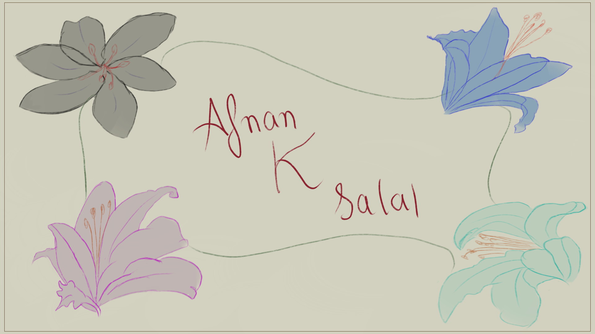

# Afnan’s little corner

My personal website: things I’m building, a little about me, and a garden of lilies drawn by my best friend, Lyra.

**[Visit the site](https://portfolio.afnan.codes)** · **[Meet the artist](https://portfolio.afnan.codes/art)**



## The site

- Lilies reveal their color on hover or touch.
- A signed illustration slides away to welcome visitors.
- A floating glass navigation bar refracts the artwork behind it, with a frosted fallback for other browsers.
- The homepage features Genmotion, Co-op, BreachScope, and Frag.
- Lyra’s gallery introduces **Morana, Isolde, Violet, and Inara**.

Built with React, TypeScript, Vite, and Framer Motion. The color reveal uses Canvas 2D; the rest is CSS. Tailwind provides the base CSS reset. There is no backend, account system, or API key setup.

## Run locally

Use Node.js 22.12 or later and npm.

```sh
git clone https://github.com/Afnanksalal/portfolio.git
cd portfolio
npm ci
npm run dev
```

Open [localhost:8080](http://localhost:8080).

| Command             | Purpose                                               |
| ------------------- | ----------------------------------------------------- |
| `npm run dev`       | Start the development server                          |
| `npm run typecheck` | Check application and build configuration types       |
| `npm run lint`      | Run ESLint with zero warnings allowed                 |
| `npm run build`     | Type-check and create the production build in `dist/` |
| `npm run preview`   | Serve the production build locally                    |

## Where things live

```text
src/
  components/       Lily artwork, hover reveal, and glass navigation
  pages/            Homepage, Lyra’s gallery, and not-found page
  App.tsx           Routes and the welcome transition
  index.css         Visual styles and responsive layouts
public/
  art/              Lyra’s original drawings
  _redirects        Netlify fallback for client-side routes
docs/
  design.md         Visual and interaction decisions
  verification.md   Verification notes
```

Edit the introduction, project list, and social links in `src/pages/Index.tsx`. Lyra’s gallery and site links are in `src/pages/Art.tsx`. Artwork names and SVG view boxes are in `src/components/LyraFlower.tsx`.

## Artwork

All lily illustrations are by **Lyra**. Her drawings give this site its identity.

- [Lyra’s personal site](https://nevis.nekoweb.org/)
- [Lyra’s portfolio](https://lyradossier.vercel.app/)

The original image exports are preserved in `public/art/`. Please ask Lyra before reusing her artwork in another project.

## Deployment

The production site is hosted on Netlify at [portfolio.afnan.codes](https://portfolio.afnan.codes). Pushes to `main` trigger deployment.

- Build command: `npm run build`
- Publish directory: `dist`
- Node version: `22`, also recorded in `.nvmrc`

Keep `public/_redirects` so opening or refreshing `/art` works. GitHub Actions runs linting and the production build for pull requests and pushes to `main`.

## Contributing

Bug reports and focused improvements are welcome. See [CONTRIBUTING.md](CONTRIBUTING.md) for the development checks and [the design notes](docs/design.md) before changing the visual direction.

## License

Source code and documentation are available under the [MIT License](LICENSE). Lyra’s original artwork is excluded from that license; see [the artwork credits](public/art/README.md).
